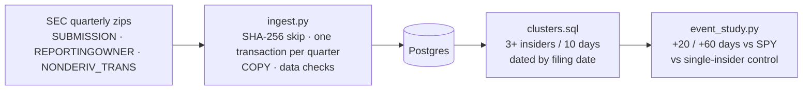

# insider-cluster-radar

A data pipeline that loads every SEC Form 3/4/5 insider trade into Postgres,
detects **cluster buys** (3+ officers/directors buying their own company's stock
on the open market within 10 days), and runs an **event study against a control
group** to test whether clusters actually beat the market.

## Result (Jan 2024 – Jun 2025, ~470k trades)

| 60 trading days after the signal | Cluster buys | Single-insider buys (control) |
|---|---|---|
| Events with prices | 806 | 1,242 |
| Beat SPY | 43.5% | 42.1% |
| Median excess return vs SPY | −2.7% | −3.1% |
| Cluster minus single | **t = −0.2 (no difference)** | |

At 20 days, clusters lagged SPY by 1.65% (t = −3.45).

**The classic "cluster buys beat the market" effect did not show up here.** Many
2024–25 clusters were micro-cap banks and financing rounds where directors
bought into an offering (e.g. ACTU: 24 insiders, $1.9B) rather than independent
open-market bets. Possible next filters: drop windows above a dollar cap, require
≥2 trade days, and exclude 10b5-1 scheduled trades.

## Pipeline



## Engineering decisions
- **Idempotent loads.** Each quarter is fingerprinted (SHA-256). Re-running with the same file is a no-op; a changed file replaces that quarter inside one transaction, so duplicates are impossible (tested).
- **Checks that can reject a load.** Missing-trade-date rate and price-less-purchase rate are checked before commit. A failure rolls back the whole quarter. The 10% purchase-price limit came from measuring the source: about 7.5% in 2024Q1 and 1–2% in every other quarter.
- **Bulk COPY, not row INSERTs.** The largest quarter (2024Q1, 111k trades) loads in about 13 s on a laptop; the cluster query over all quarters runs in 1.4 s.
- **No look-ahead.** Signals are dated by when the last Form 4 became public (filing date), not the trade date. Entry is the next trading day's close.
- **A control group, not just a headline number.** Clusters are compared with lone-insider buys from the same period, and returns are winsorized at 1/99% so a few penny-stock blowups don't dominate the means.
- **Data minimization.** The source includes insiders' street addresses. They're never loaded.

## Run
```bash
pip install -r requirements.txt
initdb -D .pgdata -U radar --auth=trust && echo "port = 5433" >> .pgdata/postgresql.conf && pg_ctl -D .pgdata start
createdb -h 127.0.0.1 -p 5433 -U radar insider
# put <quarter>_form345.zip files from sec.gov "Insider Transactions Data Sets" into data/ as 2024q1.zip, ...
python -m radar.ingest          # safe to re-run
python -m radar.event_study
pytest -q
```

## License
MIT
